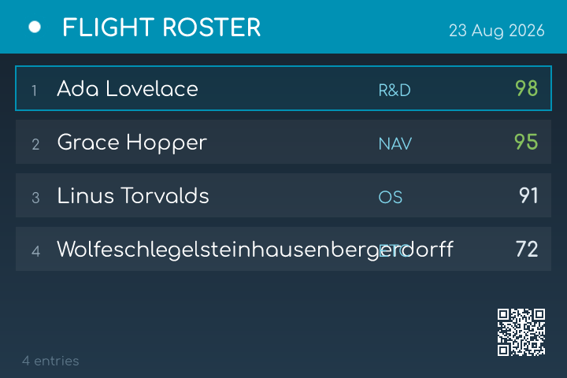
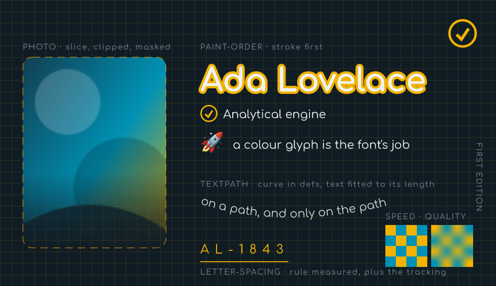
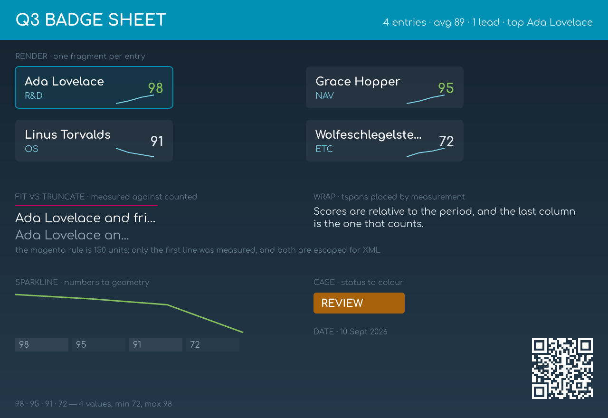
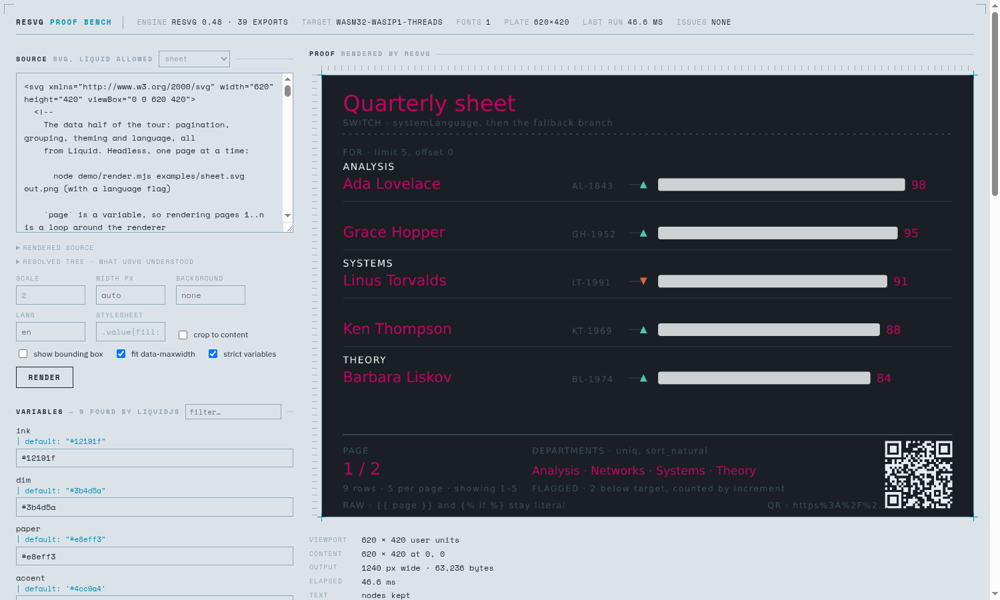

# Render and inspect SVG

[](https://www.npmjs.com/package/resvg-napi)
[](#conformance)
[](#licence)

Render an SVG to PNG, and read back what the renderer made of the document — the
resolved tree, text metrics, paint, geometry. Node.js bindings for
[resvg](https://github.com/linebender/resvg) 0.49, generated from the upstream
Rust sources, so the TypeScript surface is usvg's own, names and doc comments
included.

**[Try it in the browser](https://p8nut.github.io/resvg-napi/)** — the same
bindings compiled to WASI, rendering in the page, nothing to install.

```bash
npm install resvg-napi
```

Node.js 20.3 or later. The WASI build, used where no native binary exists, needs
20.19+, 22.13+ or 23.5+: its emnapi runtime is ESM-only and the loader
`require`s it.

The WASI package declares `cpu: ["wasm32"]`, so npm skips it on every real
host. Where no native binary matches — StackBlitz, WebContainer — ask for it:
`npm install --cpu=wasm32` (yarn: `supportedArchitectures.cpu`). The same gate
makes a plain `npm install resvg-napi-wasm32-wasi` on x64 or arm64 fail with
`EBADPLATFORM`, and the browser entry (`browser.js`) needs that package: a
bundler build on such a host adds `--force` to that command, or installs
`resvg-napi` with `--cpu=wasm32` and gives up the native package.

```js
import { renderPng, parse } from 'resvg-napi/helpers'

renderPng(svg, { width: 1200, background: '#fff' })   // Buffer, system fonts, safe on untrusted SVG
const { tree, pendingImages, pendingFonts } = parse(svg, { fonts: ['Brand.ttf'] })
```

Two layers. **`resvg-napi/helpers`** is the short way, in JS: SVG in, PNG out,
guarded by default. **`resvg-napi`** is the crates themselves, one namespace
per crate (`usvg`, `resvg`, `tiny_skia`, `fontdb`, `svgtypes`), mirroring
their Rust API: read the Rust docs, call the same names in camelCase.
`index.d.ts` is the reference: it is generated, so it cannot drift. What
follows is the map. Coming from 0.9's `Resvg` class? See [Upgrading from
0.9](#upgrading-from-09).

## Helpers

`resvg-napi/helpers` is plain JS on the raw API below, safe on untrusted input
by default.

```js
import { renderPng, renderPngAsync, parse, renderNodePng, measureText } from 'resvg-napi/helpers'

renderPng(svg)                                         // Buffer, system fonts
renderPng(svg, { width: 1200, background: '#fff' })    // sized, on white
await renderPngAsync(svg, { scale: 2, signal })        // off the event loop

const { tree, pendingImages, pendingFonts } = parse(svg, {
  fonts: ['Brand.ttf', brandBytes],     // or a fontdb.Database; default: the system's
  images: { 'logo.png': logoBytes },     // tried first, by href
  resourcesDir: '/srv/templates',        // files only from here
})
renderPng(tree, { crop: { x: 0, y: 0, width: 100, height: 50 } })
renderNodePng(tree.nodeById('badge'), { scale: 4 })   // one element, sized to it
measureText('Ada Lovelace', { fontSize: 14, family: 'Inter' })
```

| | |
|---|---|
| `parse(svg, options?)` · `parseAsync` | `{ tree, pendingImages, pendingFonts }` |
| `renderPng(svg \| tree, options?)` · `renderPngAsync` | PNG `Buffer` |
| `renderRaw(svg \| tree, options?)` · `renderRawAsync` | `{ width, height, data }`, un-premultiplied RGBA8 |
| `renderNodePng(node, params?)` · `renderNodePngAsync` | one `usvg.Node`, in a PNG the size of its extent |
| `measureText(text, options?)` | the width a string draws at, in user units |
| `fitTextWidths(svg, options?)` | [fit `data-maxwidth` text](#fitting-text-to-a-width) |
| `nodeExtent(node)` | where a node draws, `{ x, y, width, height }`: a group's layer box, a shape's stroke box |
| `systemFonts()` · `systemFontsAsync()` | the shared system font database |

- **Options.** `usvg.Options` (`fontFamily`, `dpi`, `languages`,
  `resourcesDir`, `defaultSize`...) plus `fonts`, `images` and
  `resourcesRoot`; a render takes `width` / `height` / `scale`, `background`
  (any CSS colour), `crop` (a `{ x, y, width, height }`, a `tiny_skia.Rect` or
  a `tiny_skia.NonZeroRect`) and `maxPixels` in the same object. Given a
  parsed tree, a render ignores the parse options and leaves the tree as it
  was.
- **Safe by default.** Every parse gets a fresh `guard.ImageHrefResolver`
  and `guard.FontResolver` ([Untrusted SVG](#untrusted-svg)): files only under
  `resourcesDir`, SVGZ refused with advice (`SvgzFeatureNotEnabled`, see
  [Troubleshooting](#troubleshooting)). Pass your own provider as
  `imageHrefResolver` / `fontResolver` to read its `misses()`. There is no
  unguarded parse here: for trusted SVG and usvg's own resolvers, parse with
  `usvg.Tree.fromStr` and hand the tree to `renderPng`.
- **Fonts.** Without `fonts`, the system fonts, scanned once and shared: on a
  worker thread by the async helpers, in place by the sync ones (the first sync
  call pays for the scan). Under WASI the system has none: pass `fonts`.
- **`maxPixels`** (default 2^26, an 8192×8192 canvas) is checked before the
  canvas is allocated, so a document declaring `width="200000"` throws instead
  of aborting the process. A group with a filter or opacity renders through a
  layer of its own, which can be larger: raise it with care.
- **The async helpers** take a `signal`. A parse, a render and a PNG encode
  are one worker trip each.

The sizes are 0.9's `Resvg.renderPng`, to the pixel, for the same document and
params (`test/helpers/`). One deliberate difference: `renderNodePng` places a
group with a `transform` of its own where it draws, where 0.9 applied that
transform twice.

In a browser, the bundler's `browser` condition resolves `resvg-napi/helpers`
to a variant that loads no binding: build the set on the module the page
loaded.

```js
import { createHelpers } from 'resvg-napi/helpers'
import * as binding from './resvg.js'   // the wasm loader
const { renderPng } = createHelpers(binding)
```

The package has an `exports` map: `resvg-napi`, `resvg-napi/helpers` and
`resvg-napi/package.json`. Other deep imports are closed.

## The raw API

One namespace per crate, each type under the crate that defines it, Rust names
in camelCase. Rendering is Rust's loop:

```js
import { usvg, resvg, tiny_skia, fontdb } from 'resvg-napi'

const db = new fontdb.Database()
db.loadSystemFonts()                                   // usvg's default database is empty
const tree = usvg.Tree.fromStr(svg, { fontdb: db, dpi: 192 })
const size = tree.size().toIntSize()
const pixmap = new tiny_skia.Pixmap(size.width() * 2, size.height() * 2)
resvg.render(tree, tiny_skia.Transform.fromScale(2, 2), pixmap)
pixmap.encodePng()                                     // Buffer
```

| | |
|---|---|
| `usvg` | `Tree` (`fromStr`, `fromData`, `toString`, `root()`, `nodeById`, the definition tables), the nodes (`Group`, `Path`, `Image`, `Text`, as a `{ kind, value }` union), `ClipPath`, `Mask`, `Pattern`, the paint servers and filters, `Options` and `WriteOptions` as plain objects |
| `resvg` | `render(tree, transform, pixmap)`, `renderNode(node, transform, pixmap)` |
| `tiny_skia` | `Pixmap` (`encodePng`, `decodePng`, `data`, `takeDemultiplied`...), `Transform`, `Rect`, `NonZeroRect`, `Size`, `IntSize`, `Point`, `Color`; a path's segments |
| `fontdb` | `Database` (`loadSystemFonts`, `loadFontData`, `loadFontFile`, `loadFontsDir`, `faces()`, the generic-family setters), `FaceInfo` |
| `svgtypes` | `Color.fromStr`, CSS colours as an SVG attribute reads them |
| `guard` | `ImageHrefResolver`, `FontResolver`: the [untrusted SVG](#untrusted-svg) opt-in, resvg-napi's own |
| root | `setLogLevel`, `takeLogs` ([Warnings and logs](#warnings-and-logs)) |

- **Options** are plain objects: every field optional, the rest from Rust's
  `Default`, so `usvg.Options` left out means an empty font database, as in
  Rust: text then draws nothing. Fields with no JS form take a class instance:
  `fontdb` a `fontdb.Database`, `defaultSize` a `tiny_skia.Size`
  (`tiny_skia.Size.fromWh(w, h)`), the resolvers the `guard` classes.
- **Classes.** `new` is the constructor, and throws where Rust returns `None`;
  every other `Option` is `null`. Plain-data classes (`Transform`, `Point`,
  `svgtypes.Color`) have `fromObject` / `toObject`; `FromStr` is `fromStr`,
  `Display` is `toString`. A Rust tuple is an array (`dimensions()` is
  `[w, h]`, a face's `families` `[name, language]` pairs).
- **Errors.** A `Result` throws an `Error` whose `code` is the Rust variant's
  name and whose `message` is its `Display`, typed per enum (`usvg.ErrorCode`:
  `NotAnUtf8Str`, `SvgzFeatureNotEnabled`, `MalformedGZip`,
  `ElementsLimitReached`, `InvalidSize`, `ParsingFailed`).
- **Async twins**, a worker thread each, with an `AbortSignal` last:
  `usvg.Tree.fromStrAsync` / `fromDataAsync` / `toStringAsync`,
  `resvg.renderAsync` / `renderNodeAsync`, `tiny_skia.Pixmap.encodePngAsync`,
  `fontdb.Database.loadSystemFontsAsync` / `loadFontsDirAsync`. A pixmap an
  async call draws on is in use until it settles: any other use throws
  `Leased`.
- **`dispose()`** on every class frees its value now instead of at garbage
  collection; any later call throws `Disposed`. `using x = …` calls it at the
  end of the block, on runtimes with `using` (Node 24, Chrome 134, Firefox
  141). Where `Symbol.dispose` is missing (iOS Safari at the time of writing),
  call `dispose()` yourself.
- **The raw API behaves like Rust**: a huge `new tiny_skia.Pixmap(w, h)`
  aborts the process on the failed allocation, and usvg's default resolvers
  read any path. The helpers check both.

## Text as outlines

`tree.toString()` hands back the resolved tree with **the text converted to
paths** — an SVG that draws the same where the font is not installed, which is
what a print or PDF pipeline needs from a template:

```js
const { tree } = parse(svg, { fontFamily: 'DejaVu Sans', fonts })
tree.toString()                        // one <path> per glyph, no <text>
tree.toString({ preserveText: true })  // <text> kept, resolved but not outlined
tree.toString({ indent: 'none' })      // one line; also a number of spaces, or 'tabs'
await tree.toStringAsync()             // off the event loop
```

The outlines come from the same layout `renderPng` draws, so a glyph sits where
the raster puts it — and its stroke box measured it before either.

## Inspect the usvg tree

The tree is `usvg`'s: `usvg.Tree.fromStr` (or the helpers' `parse`) parses,
`tree.root()` is the root `usvg.Group`, and `group.children()` and
`tree.nodeById(id)` hand back `usvg.Node`s, `{ kind, value }` objects that
TypeScript narrows on `kind`:

```js
import { usvg, fontdb, tiny_skia, resvg } from 'resvg-napi'

const db = new fontdb.Database()
db.loadSystemFonts()                      // usvg's default database is empty
const tree = usvg.Tree.fromStr(svg, { fontdb: db })
const n = tree.nodeById('surname')        // { kind: 'group' | 'path' | 'image' | 'text', value }
if (n?.kind === 'path') n.value.fill()    // fill, stroke, data(), boxes
if (n?.kind === 'text') n.value.chunks()  // chunks, layouted spans, positioned glyphs, decoration
if (n?.kind === 'group') n.value.opacity() // transform, blendMode, isolate, filters…
```

Like usvg's in Rust, these options read any local path an `<image href>`
names: parse untrusted SVG with the `guard` providers ([Untrusted
SVG](#untrusted-svg)).

Each value keeps its tree alive and finds its node again on each call, so it
outlives the `tree` variable. `text.flattened()` is that text's glyphs as a
group of paths, the outlines `renderPng` draws. A span carries what it is drawn
with, down to the lines through it:

```js
const span = n.value.chunks()[0].spans[0]
span.decoration.underline?.fill?.paint  // …and .overline, .lineThrough
```

Definitions hold nodes too: `tree.patterns()`, `tree.masks()` and
`tree.clipPaths()` (or `group.clipPath()`, `group.mask()`) each have `root()`,
the group of their content. What an `feImage` primitive draws, and the
document an `<image>` embeds, are not reachable yet.

`resvg.renderNode(node, transform, pixmap)` draws one node on a
`tiny_skia.Pixmap`, as Rust's `resvg::render_node` does: in the node's own
coordinates, offset by its layer box. The helpers' `renderNodePng` sizes and
places it for you.

A path's geometry is what Rust's `path.data().segments()` iterates:
`tiny_skia_path::PathSegment` as a union, one point or an array of them per
segment, each point a plain `{ x, y }` (`tiny_skia.PointObject`):

```js
path.data()
// [{ type: 'moveTo', value: { x: 10, y: 10 } },
//  { type: 'quadTo', value: [{ x: 60, y: 30 }, { x: 30, y: 50 }] },
//  { type: 'close' }]
```

A `tiny_skia::Path` cannot be a class of its own here: `usvg.Path` has that
JS name, and napi keeps one constructor per class name.

Paint is a discriminated union, so TypeScript narrows it:

```ts
const paint = n.value.fill()?.paint
if (paint?.type === 'color') paint.value   // { red, green, blue }
else paint?.id                             // the gradient or pattern it names
```

## Untrusted SVG

The raw API behaves like Rust: without a resolver, usvg reads any local
path an `<image href>` names (`/etc/…`, `../`, a FIFO) and decodes any image,
however large it says it is. The `guard` providers are the opt-in that does
not, and every helper that parses caller SVG uses them:

```js
import { usvg, guard } from 'resvg-napi'

const images = new guard.ImageHrefResolver({
  images: { 'logo.png': logoBytes }, // tried first, by href
  resourcesDir: '/srv/templates',    // files only from here (resourcesRoot widens it)
})
const fonts = new guard.FontResolver()
const tree = usvg.Tree.fromStr(svg, { fontdb: db, imageHrefResolver: images, fontResolver: fonts })
images.misses() // hrefs nothing resolved: ['photo.jpg']
fonts.misses()  // named families the database lacks: ['Brand Sans']
```

`guard.ImageHrefResolver` reads files only under `resourcesDir` (its own, or
the parse options'; with neither, none), canonicalised so `..`, absolute paths
and symlinks cannot leave it, and only regular files of at most 256 MiB,
opened without following a final symlink. Whatever the source, it refuses
gzip data (SVGZ) and any raster image whose header declares more than 2^28
pixels, and logs the refusal. The async twins (`fromDataAsync`,
`fromStrAsync`) carry the resolvers to the worker thread; `misses()` reads
what they recorded once the promise settled. Use one instance per parse: one
shared between parses lists the misses of them all.

## Measure text and geometry

Every node reports `boundingBox()`, `absBoundingBox()`, `strokeBoundingBox()`
and `absStrokeBoundingBox()` (a `tiny_skia.Rect`), and a group
`layerBoundingBox()` and `absLayerBoundingBox()` (a `tiny_skia.NonZeroRect`)
— in the document's own units, which is not the canvas. Their sides are
methods: `box.width()`. `nodeExtent(node)` from `resvg-napi/helpers` is where
a node will draw, as a plain `{ x, y, width, height }`: a group's layer box, a
shape's or a text's stroke box. See [Fitting text to a
width](#fitting-text-to-a-width) for why the units bite.

## Fonts

`fontdb.Database` is `fontdb` itself: `loadSystemFonts()`,
`loadFontData(buffer)`, `loadFontFile(path)`, `loadFontsDir(dir)`, `faces()`,
and the generic-family setters. A `fontdb.FaceInfo` reports its `families`
(`[name, language]` pairs, English (US) first: `face.families[0][0]` is the
name `fontFamily` takes), `postScriptName`, `weight`, `style` (`'normal' |
'italic' | 'oblique'`), `stretch` and whether it is `monospaced`. A parse
shares the database rather than copying it; writing to it afterwards copies
it first. The helpers' `pendingFonts` names the families a document wanted
and did not get; `pendingImages` does the same for hrefs.

Not reachable yet, because their Rust signatures borrow or take a closure:
`query`, `faceData`, `familyName`, `faceSource`, the face `ID`s, and which
face drew each glyph ([#181](https://github.com/p8nut/resvg-napi/issues/181),
[#191](https://github.com/p8nut/resvg-napi/issues/191)).

## Paint servers

`tree.linearGradients()`, `radialGradients()`, `patterns()`, `clipPaths()`,
`masks()`, `filters()` — the paint servers an element's `id` refers to.

## Examples

Four templates in [`demo/examples/`](demo/examples), each rendered by
`node demo/render.mjs <template.svg>`: Liquid fills the template from the JSON
file next to it, this binding rasterises the result. The images below are that
command's output.

### Roster — a table from a JSON array



A `staff` array becomes rows, with an embedded logo and a QR code generated
during templating. The fourth name runs straight into the column beside it —
measuring that overflow, and compressing it away, is what [Fitting text to a
width](#fitting-text-to-a-width) below is for.

### Photo card — images and glyphs



Everything a card does with raster images and type, and nothing it does with
data.

### Badge sheet — one template, stamped per record



Pulls `badge.svg` in as a partial and repeats it. A guided tour, where every zone
of the page is one Liquid capability.

`sheet.svg` covers the data half — pagination, grouping, theming, and
`--lang fr` driving `<switch systemLanguage>`, which usvg picks nothing from
without a language.

## Conformance

resvg's own test corpus, rendered through these bindings: **1715 of 1715 match**
the reference PNGs upstream asserts on, within 1/255 per channel — a tolerance
measured rather than chosen, with the reason recorded in
[`scripts/conformance.mjs`](scripts/conformance.mjs).

```bash
npm run conformance:fetch   # the corpus, at the tag Cargo.lock builds
npm run conformance         # 15 seconds including the fetch
```

CI runs it on every pull request, so a resvg bump that changes a render shows up
as a diff rather than passing unnoticed.

## Platforms

Thirteen targets.

| | x64 | arm64 | armv7 | ia32 |
|---|---|---|---|---|
| Linux (glibc) | ✅ | ✅ | ✅ | — |
| Linux (musl) | ✅ | ✅ | — | — |
| macOS | ✅ | ✅ | — | — |
| Windows (MSVC) | ✅ | ✅ | — | ✅ |
| Android | — | ✅ | ✅ | — |
| WASI (`wasm32-wasip1-threads`) | ✅ | — | — | — |

The dependency tree is pure Rust — `fontconfig` support comes from
`fontconfig-parser`, not the C library — so every target cross-compiles without
a system SDK.

The WASI build is the same generated bindings on emnapi instead of node-api, and
it is complete: rendering, `toString`, bounding boxes, the node walk, the async
twins (threads via `wasm32-wasip1-threads`) and even filesystem image
resolution all work. Two differences: `loadSystemFonts()` finds 0 faces inside
the sandbox, so fonts must be supplied with `loadFontFile(path)`,
`loadFontsDir(dir)` or `loadFontData(buffer)` — the demo fetches them from
google/fonts by name rather than making you find a file; and WASI has no mmap,
so font files are read into memory.

Adding a target is the triple in `package.json` under `napi.targets`; then
`npm run create-npm-dirs`. CI builds that list, and `scripts/ci-targets.mjs`
derives which host builds each triple and which cross-compilation flag it needs.

CI does not build all thirteen on a pull request. It builds the two that can
tell it something — `x86_64-unknown-linux-gnu`, which the tests, the drift
checks and the conformance suite run on, and `wasm32-wasip1-threads`, whose
generated shims and test run are a different code path. The other eleven build
on the merge, on a `v*` tag, on a manual dispatch, or on a pull request labelled
`full-matrix` when the proof is wanted before merging rather than after.

## Fitting text to a width

An Illustrator template says how wide a field may be on the element itself
(`data-maxwidth="85"`), which is not SVG — resvg drops it. `fitTextWidths` reads the
constraint from the source, measures the text with `nodeExtent` on the
`usvg.Tree` you parse it with, and compresses the element horizontally, composing a
`scale(k 1)` onto whatever transform it already has (the same device those
templates use by hand):

```js
import { fitTextWidths } from 'resvg-napi/helpers'

const { svg, adjustments, problems } = fitTextWidths(source,
  { fontFamily, fonts: db, resourcesDir, images })
// adjustments: [{ id: 'surname', from: 200.23, to: 90, factor: 0.4495, measured: 90.0031 }]
```

Each pass parses as the helpers' `parse` does, through the guard (see
[Untrusted SVG](#untrusted-svg)). A `render` function, `(s) => usvg.Tree`,
works in place of the options; `guardedParse(binding, options)` is one that
keeps the guard. A plain `(s) => usvg.Tree.fromStr(s, …)` works too, but
without a resolver usvg resolves `<image href>` from any local path, as it
does in Rust: only for trusted SVG.

The limit is read in **the document's own units**, the ones the attribute is
written in. That matters: `width="85.6mm"` with a `viewBox` 240.94 wide makes usvg
normalise the tree to 323.53 units, so an extent comes back 1.343× larger than
anything the file says. Comparing raw canvas widths compresses text that actually
fits — everything past `limit / 1.343`.

No `id` needed: an element that has none gets one generated, numbered in document
order, so the constraint does not depend on the template carrying ids. The scale
is anchored at the element's own `x` — a bare `scale()` is anchored at the origin
and slides the text left as it narrows.

A geometric scale is exactly linear in width, so one pass lands on the target;
the second measurement is a check, and it is reported. Text that already fits is
left untouched, and a constraint that cannot be honoured says why: no `id` to
measure by, no visible extent, or an unusable width. It compresses glyphs rather
than reducing `font-size` — the choice the templates already made.

## Warnings and logs

usvg and resvg report every recoverable problem through the `log` crate —
unparsable values, skipped shapes, unmatched font families, images that could not
be read. Nothing consumes that by default, so those messages used to vanish:

```js
import { setLogLevel, takeLogs } from 'resvg-napi'
import { renderPng } from 'resvg-napi/helpers'

setLogLevel('warn')            // off | error | warn | info | debug | trace
renderPng(svg)
takeLogs()
// [ "WARN usvg::parser::style: Failed to parse fill value: 'notacolour'. Fallback to black.",
//   "WARN usvg::parser::shapes: Rect '' has an invalid 'width' value. Skipped." ]
```

`takeLogs()` drains the buffer, which is capped at 500 entries so a pathological
document cannot grow it without end. A full buffer ends with a
`WARN napi_support::logs: log buffer full (500 entries), later messages dropped`
line. It collects from every call and thread, worker threads included, so
concurrent renders interleave there. (0.9 also kept each `Resvg`'s own; that
went with the class.)

## Troubleshooting

**A font family did not apply.** `pendingFonts` from the helpers' `parse` (or
a `guard.FontResolver`'s `misses()`) names the families the document asked for
and did not get. Supply them as `fonts` (files or buffers), or with
`loadFontFile(path)` or `loadFontData(buffer)` on your `fontdb.Database`,
before parsing. Under WASI, `loadSystemFonts()` finds nothing inside the
sandbox, so every face has to be loaded by hand.

**An image did not appear.** `pendingImages` names the hrefs that could not be
resolved. Files are read from disk only below `resourcesDir`: an absolute path,
a `..` or a symlink leading out of it is refused, and without `resourcesDir` the
disk is not read at all. `resourcesRoot` widens the fence to an ancestor, so a
template can still reach `../assets/logo.png`; or hand the bytes over as
`images` instead. Bytes fetched after the parse go back by parsing again with
them in `images`. Refused, because each
would otherwise be allocated in full: a file of more than 256 MiB, SVGZ (see
below), and a raster image whose header declares more than 2^28 pixels. An
image refused this way, or supplied bytes that are not an image at all, is
listed in `pendingImages` (a `data:` URI is only logged).

**An `.svgz` file throws `SvgzFeatureNotEnabled`.** SVGZ is not supported for
now: usvg inflates gzip with no size limit, so a few hundred bytes can expand
to gigabytes ([linebender/resvg#1138](https://github.com/linebender/resvg/issues/1138)).
Inflate it yourself, with a limit you choose, and pass the result:

```js
import { gunzipSync } from 'node:zlib'
const png = renderPng(gunzipSync(svgz, { maxOutputLength: 64 << 20 }))
```

In a browser, `DecompressionStream('gzip')` does the same; stop reading past
your limit. An SVGZ `<image>` inside a document is not drawn.

**A measurement disagrees with the numbers in the file.** Bounding boxes are in
the document's own units and usvg normalises the tree, so they are not canvas
pixels. See [Fitting text to a width](#fitting-text-to-a-width) for the arithmetic.

**Something was dropped and nothing said so.** usvg reports it through the `log`
crate and nothing consumes that by default — see [Warnings and
logs](#warnings-and-logs).

**A member is missing from the TypeScript surface.** The generator keeps a report
of every upstream member it left alone, with the reason.
`RESVG_NAPI_CODEGEN_LOG=1 cargo build` prints it, and
[CONTRIBUTING.md](CONTRIBUTING.md) explains what the reasons mean.

**Not sure which binding loaded.** `__napiBindingTarget` names it: `'native'`
for a platform addon, otherwise the WASI flavour. That separates a machine that
fell back to `wasm32-wasi` — where `loadSystemFonts()` finds nothing — from
one running the native addon, and reports what `NAPI_RS_NATIVE_LIBRARY_PATH`
resolved to when it is set, since the loader adopts the override's own target
rather than claiming `'native'`.

## Upgrading from 0.9

0.10 removed the hand-written `Resvg` class and the other flat exports
([ADR 0001](docs/adr/0001-thin-generic-wrapper.md)). What replaces each:

| 0.9 | 0.10 |
|---|---|
| `new Resvg(svg, options, fonts, images)` | `parse(svg, { ...options, fonts, images })` (helpers), or `usvg.Tree.fromStr(svg, options)` |
| `Resvg.parseAsync` · `renderAsync(svg, options, params)` | `parseAsync` · `renderPngAsync(svg, { ...options, ...params })` |
| `doc.renderPng(params)` · `renderRaw` (and `…Async`) | `renderPng(tree, params)` · `renderRaw` (and `…Async`), or `resvg.render` on a `tiny_skia.Pixmap` |
| `doc.toString(opts)` · `toStringAsync` | `tree.toString(opts)` · `tree.toStringAsync` |
| `doc.width` · `doc.height` | `tree.size().width()` · `.height()` |
| `doc.absLayerBoundingBox()` and the other boxes | `tree.root().absLayerBoundingBox()`: a `tiny_skia.NonZeroRect`, sides as methods |
| `doc.pendingImages()` · `pendingFonts()` | `pendingImages` · `pendingFonts` from `parse`, or a `guard` provider's `misses()` |
| `doc.resolveImage(s)` | parse again with the bytes in `images` |
| `doc.takeLogs()` (per document) | `takeLogs()`, global |
| `doc.dispose()` | `tree.dispose()`, on every class |
| `FontDatabase` · `FontFace` | `fontdb.Database` · `fontdb.FaceInfo` (`families` are `[name, language]` pairs) |
| `FontDatabase.query` · `faceData` · `familyName` · `faceSource` | not yet ([#181](https://github.com/p8nut/resvg-napi/issues/181)) |
| `RenderOptions` · `WriteOptions` | `usvg.Options` · `usvg.WriteOptions`; `defaultSizeWidth`/`Height` is `defaultSize: tiny_skia.Size.fromWh(w, h)` |
| `RenderParams` · `RawImage` | the helpers' `RenderParams` · `RawImage` |
| `BBox` · `Dimensions` · `Matrix` | `tiny_skia.NonZeroRect` or `Rect` · `tiny_skia.Size` · `tiny_skia.Transform` |
| `PathSegment` (`{ type, points }`) | the `tiny_skia.PathSegment*` union (`{ type, value }`, points as `{ x, y }`) |
| `ParseErrorCode` | `usvg.ErrorCode` |
| `resvg-napi/fit.mjs` | `resvg-napi/helpers` |

## Demo

The same bindings compiled to WASI, in the browser: a simple page (edit an SVG,
see the PNG resvg draws, copy the Node.js call) and, behind it, a proof bench
with Liquid templating, an array editor, per-element export and live
diagnostics. Deployed from `main` at
**[p8nut.github.io/resvg-napi](https://p8nut.github.io/resvg-napi/)**, and it
runs locally too:

```bash
npm run demo
```



[demo/README.md](demo/README.md) describes the page.

## Contributing

[CONTRIBUTING.md](CONTRIBUTING.md) — how the bindings are generated, and what to
read before touching the generator.

## Licence

Apache-2.0 OR MIT, matching resvg.
